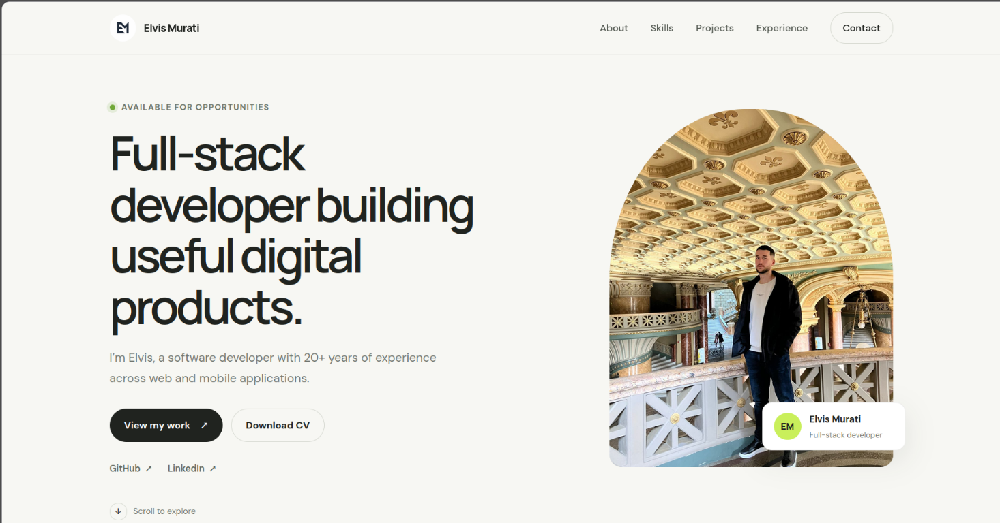

# Elvis Murati — Portofol

Portofol personal i zhvilluar me React dhe Vite. Prezanton profilin, aftësitë, projektet, përvojën dhe mënyrat e kontaktit.



## Nisja lokale

Kërkohet Node.js dhe npm. Nga folderi kryesor i repository-t:

```bash
cd ElvisProtofolio
npm install
npm run dev
```

Hap adresën lokale që shfaq Vite (zakonisht `http://localhost:5173`).

Për të verifikuar versionin e prodhimit:

```bash
npm run build
npm run preview
```

## Publikimi në Vercel

1. Ngarko repository-n në GitHub dhe zgjidh **Add New → Project** në Vercel.
2. Importo repository-n dhe vendos **Root Directory** në `ElvisProtofolio`.
3. Zgjidh **Vite**; përdor `npm run build` si Build Command dhe `dist` si Output Directory.
4. Kliko **Deploy**. Nuk nevojiten variabla mjedisi.

Pas publikimit, çdo push në branch-in e lidhur e përditëson faqen automatikisht.
